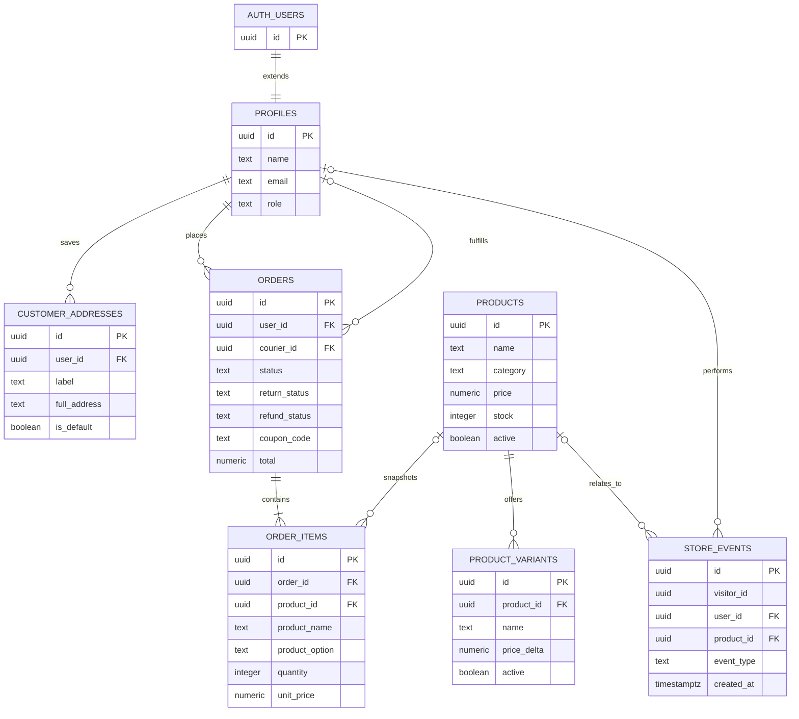
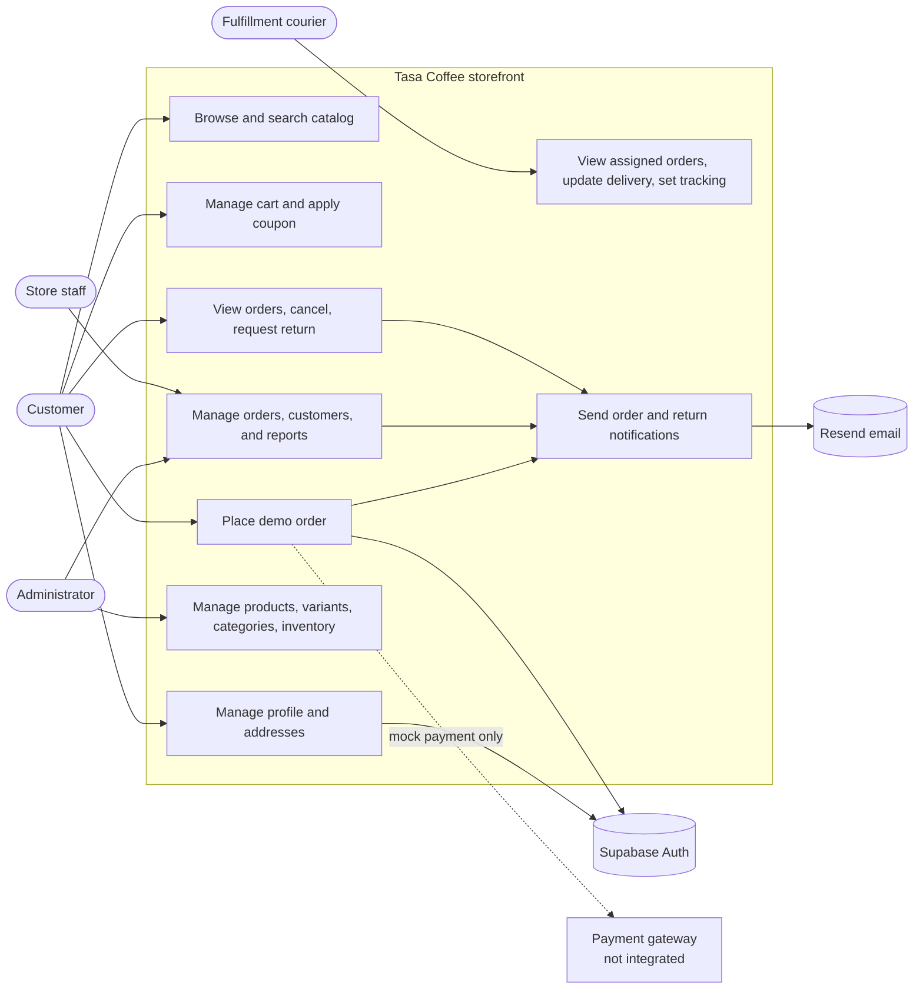

# Tasa Coffee

Tasa Coffee is a storefront built with React, TypeScript, and Vite. Supabase provides PostgreSQL, authentication, row-level security, and transactional order functions. The Vercel-ready app is in [`frontend/`](./frontend). The PHP/MySQL files at the repository root are the original implementation and are not used by the Vercel deployment.

## Local development

Requirements: Node.js 22+ and a Supabase project.

1. Create a Supabase project.
2. In the Supabase SQL Editor, run [`frontend/supabase/schema.sql`](./frontend/supabase/schema.sql).
3. Then run [`frontend/supabase/migrations/20261123_evaluation_extensions.sql`](./frontend/supabase/migrations/20261123_evaluation_extensions.sql), [`frontend/supabase/migrations/20261126_public_order_tracking.sql`](./frontend/supabase/migrations/20261126_public_order_tracking.sql), and [`frontend/supabase/migrations/20261127_menu_popularity.sql`](./frontend/supabase/migrations/20261127_menu_popularity.sql) in the SQL Editor. These add the storefront extensions, secure public order lookup, and product popularity sorting.
4. Copy `frontend/.env.example` to `frontend/.env.local` and set:
   - `VITE_SUPABASE_URL` to the project URL.
   - `VITE_SUPABASE_ANON_KEY` to the project's publishable/anon key. This key is safe for browser use only because database access is protected by RLS.
5. Run the frontend:

   ```powershell
   cd frontend
   npm install
   npm run dev
   ```

5. Register an account, confirm its email if email confirmation is enabled, then promote the first administrator in the Supabase SQL Editor:

   ```sql
   update public.profiles
   set role = 'admin'
   where email = 'admin@example.com';
   ```

   Never put a Supabase service-role key in the frontend or in a `VITE_` variable.

## Order email setup

Order emails use the `send-order-email` Supabase Edge Function and Resend. Confirmation emails include the full order number used by the Track Order page. Verify a sender address or domain with Resend, then set `RESEND_API_KEY` and `RESEND_FROM_EMAIL` as Supabase Edge Function secrets in the Supabase Dashboard. Do not put either value in this repository, in chat, or in a `VITE_` variable.

Install the Supabase CLI and deploy the function from the `frontend/` directory:

```powershell
supabase functions deploy send-order-email --project-ref <PROJECT_REF>
```

Email delivery is best-effort after the order is committed. A provider failure is reported separately and does not undo an order. Payment and refunds remain simulated; no real charge or refund is made.

## Vercel deployment

1. Import `ljttelan/tasa-coffee` into Vercel.
2. Set the project **Root Directory** to `frontend`. Vercel should detect Vite; use `npm run build` and `dist` if prompted.
3. Add `VITE_SUPABASE_URL` and `VITE_SUPABASE_ANON_KEY` as Vercel environment variables for Preview and Production.
4. Deploy, then add the resulting Vercel URL to Supabase Auth's allowed redirect URLs. Set the production site URL there as well.

Vercel automatically builds future commits pushed to the connected GitHub branch. Database authorization is enforced by the SQL policies and RPCs, not by hiding the browser anon key.

## App features

- Product search, managed categories, product variants, sorting, persistent cart, coupons, and checkout
- Supabase Auth accounts, editable profiles, saved addresses, and order history
- Public order tracking using a full, unguessable order reference; only the tracking RPC exposes the details needed by the page
- Transactional checkout with stock locking and server-side price calculation
- Customer cancellation, return requests, and clearly labeled simulated refunds
- Admin product/category/image and inventory management
- Role-based order operations, courier assignment/tracking, customer management, and analytics
- Optional Resend order confirmation, cancellation, fulfillment, and return emails

### Entity relationship diagram



`product_categories.name` and `coupons.code` are logical values stored on products/orders; the current schema does not enforce them as foreign keys.

### Use-case diagram


